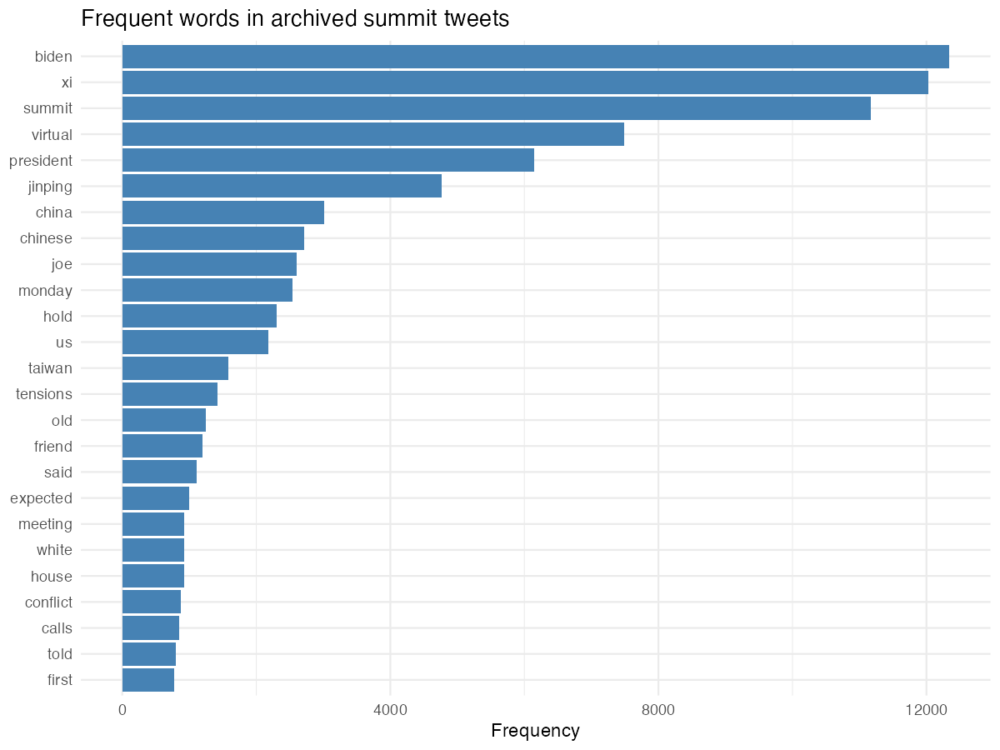
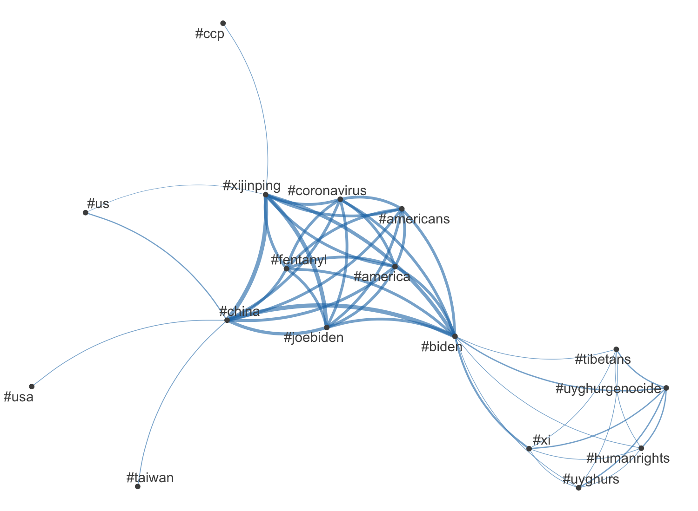
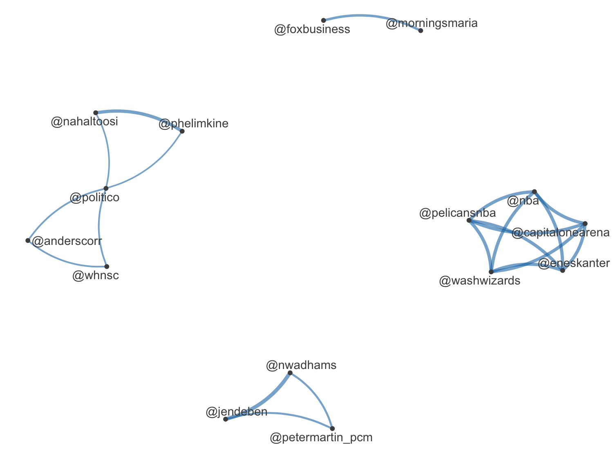
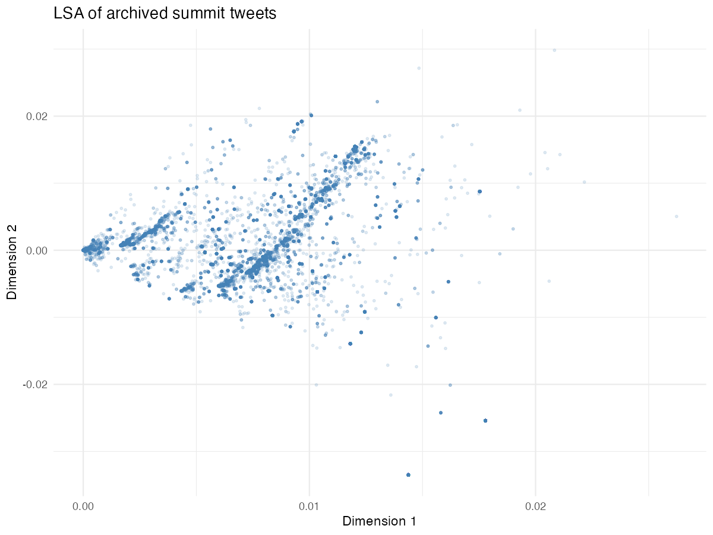
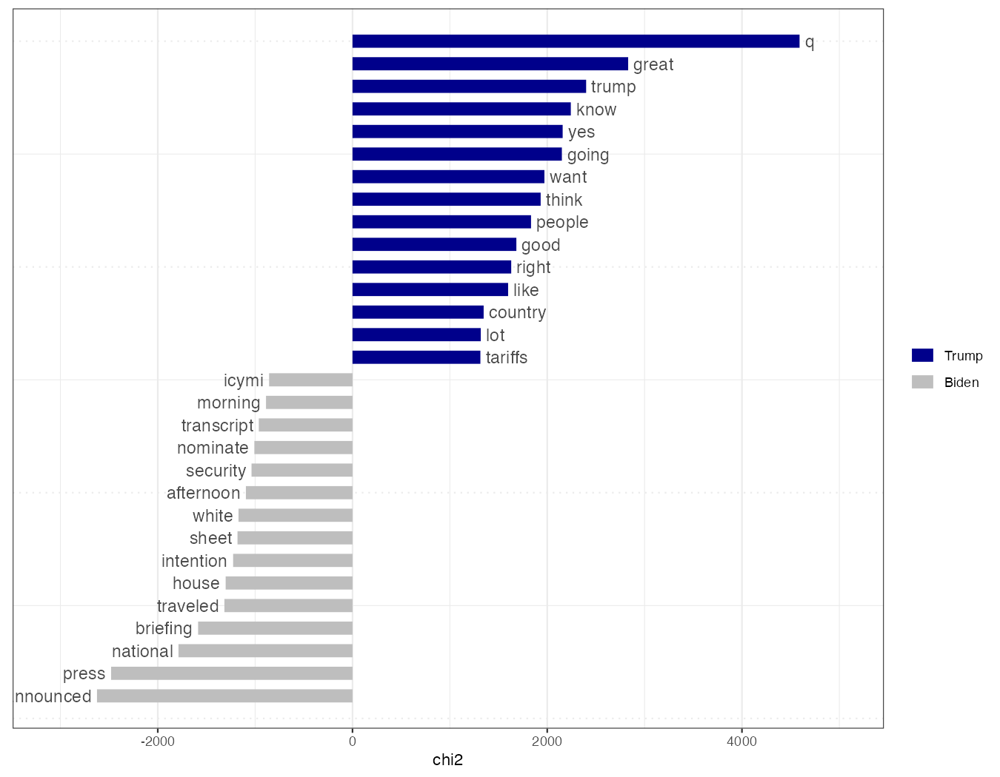
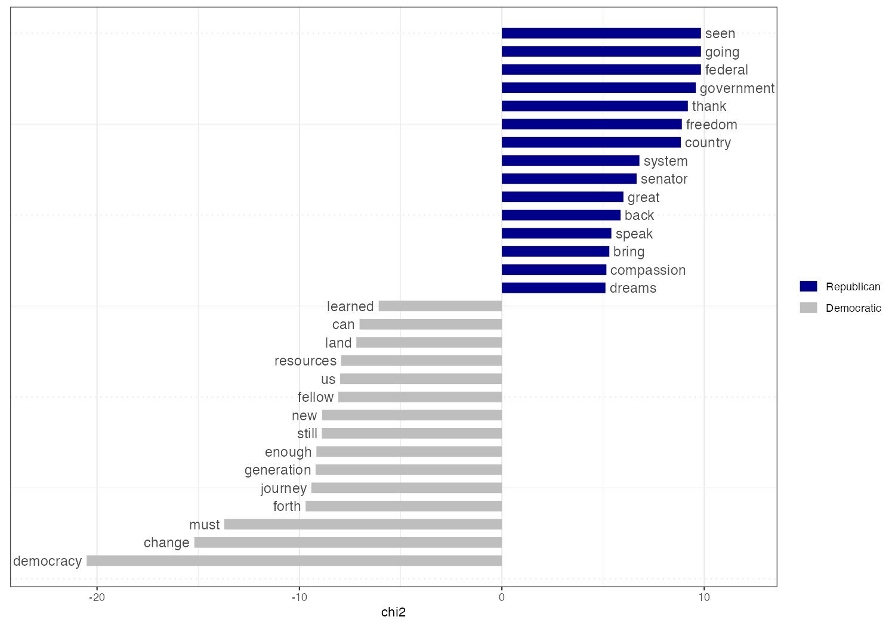

## Summit tweets and presidential documents

I constructed three quanteda corpora: archived summit tweets, GovInfo presidential documents, and inaugural addresses. Their different production and selection processes determine what the results can mean.

The tweet archive contains 14,520 posts dated November 7–16, 2021, including 9,035 retweets (62.2%). Biden, Xi, summit, and virtual dominate the cleaned word counts. The hashtag network connects leader names with coronavirus, fentanyl, and human-rights tags. Mention clusters include journalists and NBA-related accounts. Edges represent co-occurrence within tweets, not direct communication. Retweets can amplify these patterns. Four-dimensional LSA separates vocabulary such as summit/virtual from old/friend, suggesting differences in coverage and framing rather than validated political positions.

Tweets were produced by platform users, including media and advocacy accounts, for their followers and wider audiences. The archive's keyword selection and collection window make it a record of selected discourse, not representative public opinion. Its original API access cannot be reproduced today. The exact original collection query was not supplied with the script.

The CPD search returned 351 documents, all successfully downloaded: 183 assigned to Biden and 168 to Trump. KWIC shows Xi appearing in substantive discussion and editorial notes or name indexes. In one Biden passage, he describes having spent more time with Xi than other world leaders. Trump-associated keyness includes tariffs and great; Biden-associated words include national, security, and briefing. However, question labels such as q, editorial material, document genres, and unequal periods also influence this comparison. It does not isolate changes in China policy.

CPD materials originate from White House releases and are reviewed and annotated by Office of the Federal Register editors for an official public record. They reveal official presentation; tweets reveal selected circulation and reactions. The tweets concern the 2021 summit window, whereas CPD covers several years, so these are not equivalent samples of the summit or US–China relations.

## Inaugural addresses

The corpus contains 21 addresses from 1945 through 2025; Trump's 2025 address is already included. Length ranges from 555 tokens in Roosevelt's 1945 address to 2,909 in Trump's 2025 address. With a 100-token MATTR window, Reagan's 1985 address has the highest lexical diversity (0.711), and Nixon's 1973 address the lowest (0.640). Flesch–Kincaid grade estimates range from 5.78 for Biden to 12.30 for Nixon in 1973. These indicate textual properties, not intelligence or actual audience comprehension.

The most similar pair is Reagan's 1981 and 1985 addresses (cosine 0.690); Reagan 1985 and Clinton 1997 also resemble each other (0.642). Republican-associated words include federal, government, and freedom; Democratic-associated words include democracy and change. Presidents, historical circumstances, and unequal speech lengths complicate party interpretations. Inaugurals are ceremonial statements addressed to the nation, selected by an institutional tradition rather than keyword searches.

## What Wordfish measures

Wordfish assumes conditionally independent Poisson word counts, with log expected counts combining document and word effects and an interaction between document position and word discrimination. It estimates one latent dimension without assigning its substantive meaning. Here positions correlate with year (r = 0.847), and parties overlap considerably. Earlier-associated words include international and peoples; later-associated words include going and thank. This suggests historical vocabulary and rhetorical change, but validation would require close reading, external measures, and preprocessing checks. It is insufficient to label the axis liberal–conservative. I set `dir` using 1945 Roosevelt and 2025 Trump to fix the otherwise reversible axis orientation; this does not establish meaning.

## CPD data note

Source: [GovInfo CPD](https://www.govinfo.gov/help/cpd), collected November 9, 2026. Query: `collection:CPD AND "Xi Jinping" AND publishdate:range(2021-01-20,2026-11-09)`. All search pages were retrieved and package IDs deduplicated. Official HTML texts were retained locally. [GovInfo's policy](https://www.govinfo.gov/about/policies) generally permits reuse of U.S. government works, with exceptions for third-party material. The query can miss alternative names; the latest returned document is October 1, 2026, so later coverage is unverified. Editorial indexes remain in the analysis. Documents and the API key are not posted.

- [CPD collection log](assign06_files/cpd_collection_log.csv)
- [CPD collection manifest](assign06_files/cpd_manifest.csv)

## Plots

### Summit tweets

### Presidential documents

### Inaugural addresses

