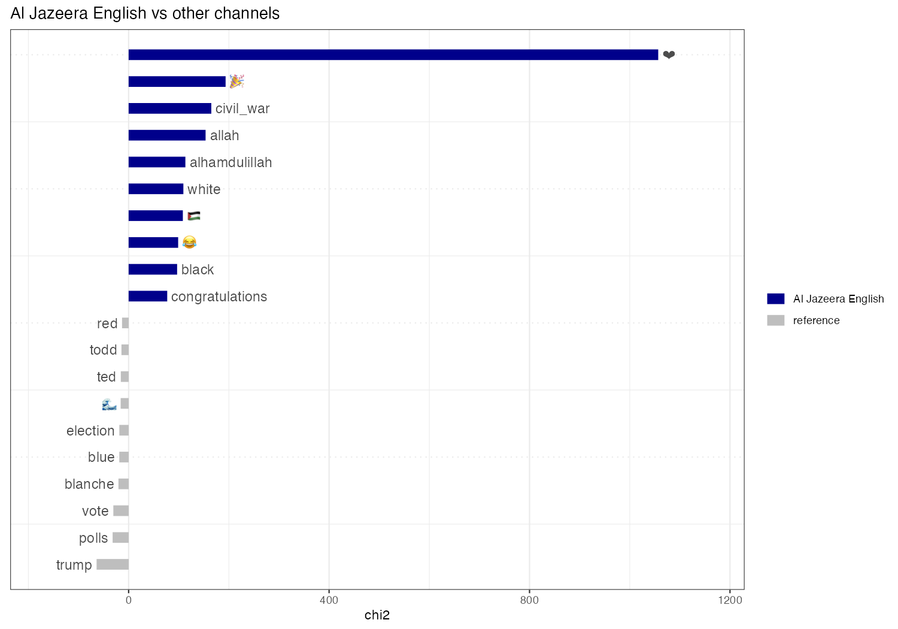
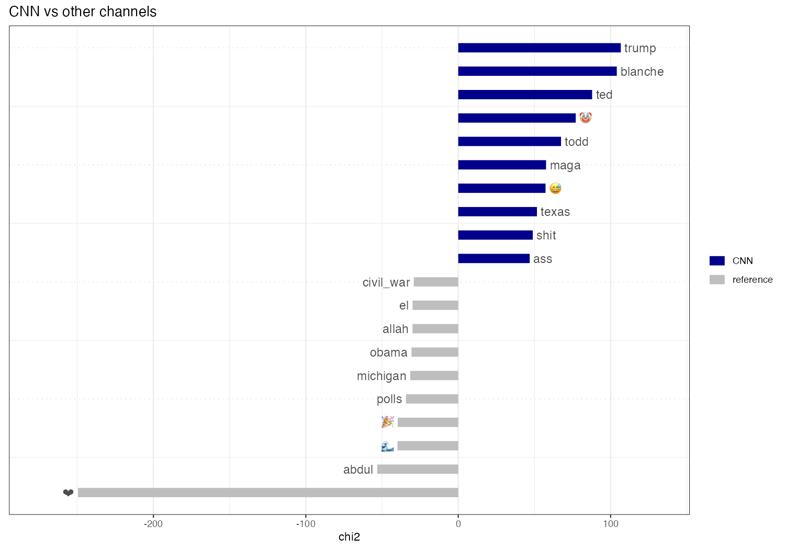
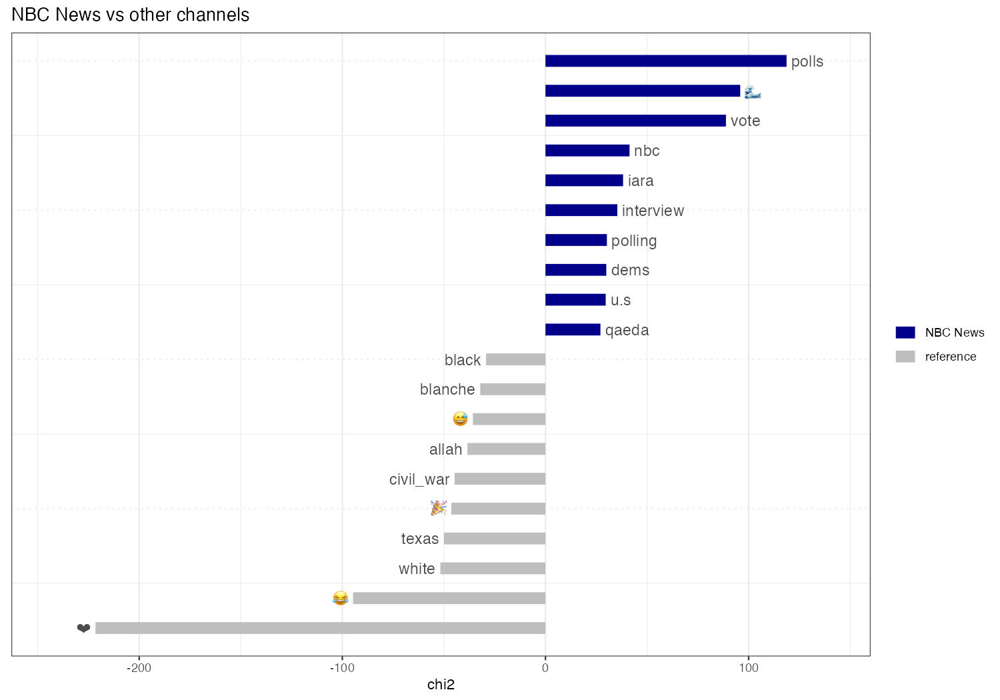
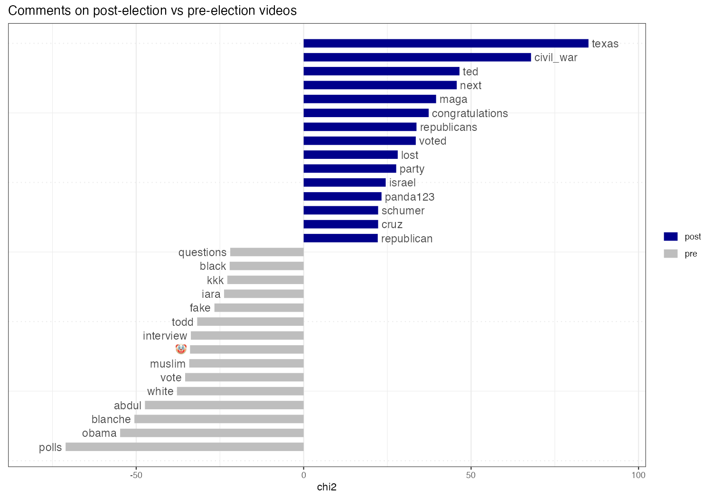
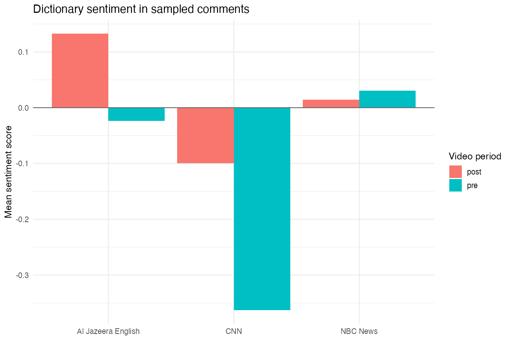

## Collection and selection

On November 17, 2026, I collected YouTube metadata and comments using tuber 3.0.0 and an API key stored outside the script. I searched `US midterm election` with relevance and view-count ordering, requesting 100 results each for September 1–October 27 and November 4–collection time. The two orderings shared 16 unique videos before Election Day and 24 afterward. Al Jazeera English led the pre-election relevance results; CNN dominated both view-count lists. FRANCE 24 English led post-election relevance results. Each response reported 1,000,000 results but returned only 100 rows, including duplicates. The reported total is not a verified inventory.

I selected NBC News, CNN, and Al Jazeera English to compare a US broadcast network, cable news, and an international broadcaster. Their uploads required 81, 63, and 81 pages respectively to reach September 1. The channel route found election-related titles absent from the capped searches. My title filter was `midterm|election|senate|house race|ballot`. Reviewing 20 retained and 20 dropped titles revealed foreign-election false positives and likely omissions among generically titled programs. I excluded identified foreign-election patterns, but did not validate every retained video. From each channel and publication period, I selected the two videos with the most reported comments.

All 12 requests succeeded, returning 300 comments each: 3,600 total. Reported counts ranged from 659 to 21,040. The cap explains incomplete coverage; moderation, deletion, reply availability, and API ordering may also affect access, but these logs cannot quantify their individual effects. No selected video returned a disabled-comments status. This does not establish channel-wide moderation practices.

## What the comments represent

The corpus unit is one comment, including replies, with channel, video, publication period, reply status, likes, and comment date as document variables. Comment IDs were deduplicated and connected to unique video metadata. A critical timing check found that 918 of 1,800 comments on pre-election videos were written on or after November 4. Thus, this is a retrospective comparison of video publication windows, not historical snapshots of opinion before and after voting.

Replies ranged from 0% to 28.2% across channel-period groups. Median likes were zero throughout. In CNN’s post-election group, the top 1% of comments received 60.6% of likes, and the most active 10% of identifiable authors produced 29.5% of comments. Repeated text beyond the first occurrence ranged from zero to 22 rows per group. These patterns show unequal participation and attention; repetition alone does not establish automation.

## Text analysis and validation

Before modeling, I inspected 20 KWIC lines each for `democrat*`, `republican*`, `trump`, `vote*`, and `ballot*`. Party labels and candidate references frequently carried blame or ridicule; ballot language often figuratively linked Trump to the midterm result. Grievances about suppression or fraud are commenters’ assertions, not verified events. I lowercased tokens, removed URLs, mentions, punctuation and numbers, and retained emoji. English stopwords were removed for keyness. Five specified election phrases were compounded, alongside the observed phrases `civil war` and `voter suppression`.

Channel-versus-others keyness distinguished hearts, celebration and religious expressions for Al Jazeera English; Trump and other named figures for CNN; and polls, voting and wave emoji for NBC. Post-election-video comments emphasized Texas, civil war, voting and losing. These differences may reflect selected video subjects, formats and audiences rather than stable channel ideology.

LSD2015 dictionary scores were more positive for post-election videos on Al Jazeera English and CNN, with little change for NBC. However, my independent coding of 40 randomly sampled comments agreed with the dictionary on only 13 (32.5%). Human labels were 11 positive, 19 negative and 10 neither. Sarcasm, ridicule, mixed sentiment and implicit praise make dictionary results unreliable as substantive conclusions.

## Comparison and data note

Assignment 6’s summit tweets reflect platform users selected by the archived collection, while presidential documents reflect institutional communication selected through official records. These YouTube comments reflect self-selected participants beneath particular news videos, further selected by popularity, API availability, ordering and caps. Tweets and comments support bounded claims about observed communication; presidential documents support claims about official presentation. None directly measures representative public opinion. Official records are generally easier to recollect; social-media results change with availability and platform access.

This collection used the YouTube Data API under its terms, with separate search and data budgets. Logs record eight search calls and 283 data units. Both publication-window manifests specify deletion by December 17, 2026; raw API data will be deleted within 30 days. Only logs, manifests, aggregate tables and plots accompany this report. API keys, raw comments and commenter identities are excluded.

## Search and quota tables

| Search | Reported Total | Received | Duplicate Ids |
| --- | --- | --- | --- |
| pre_relevance | 1000000 | 100 | 1 |
| pre_views | 1000000 | 100 | 5 |
| post_relevance | 1000000 | 100 | 2 |
| post_views | 1000000 | 100 | 0 |

| Period | Common Unique Videos |
| --- | --- |
| pre | 16 |
| post | 24 |

| Operation | Budget | Planned Ceiling | Actual |
| --- | --- | --- | --- |
| Four searches, two pages each | search | 8 | 8 |
| Channel details and uploads to September 1 | data | 604 | 226 |
| Video statistics, 802 IDs in batches of 50 | data | 17 | 17 |
| Comments, 12 videos; replies included | data | 3636 | 40 |
| Total data units | data | 4257 | 283 |

The upload budget was a conservative ceiling; pagination stopped upon reaching September 1. Reply requests made comment costs variable. Separate manifests retain the original collection timestamp because both windows were collected in the same session.

## Comment collection by video

| Video Id | Channel Title | Period | Reported Comments | Received Comments | Status |
| --- | --- | --- | --- | --- | --- |
| 1OV7Av2CsSg | Al Jazeera English | post | 2595 | 300 | ok |
| 7V2HYEE2SzY | Al Jazeera English | post | 2065 | 300 | ok |
| AerLH3llCco | CNN | post | 15274 | 300 | ok |
| 1TpMeZUrH1M | CNN | post | 12286 | 300 | ok |
| Kcvo24nct00 | NBC News | post | 951 | 300 | ok |
| rxGlzCGz-lY | NBC News | post | 942 | 300 | ok |
| BOVfS0IkWlg | Al Jazeera English | pre | 21040 | 300 | ok |
| 9gZoy1MxQ5g | Al Jazeera English | pre | 3845 | 300 | ok |
| mcGbI_ommUw | CNN | pre | 12046 | 300 | ok |
| yy5blvw2IF4 | CNN | pre | 11855 | 300 | ok |
| aSG0tp_iuqU | NBC News | pre | 1948 | 300 | ok |
| hGlJi746ll0 | NBC News | pre | 659 | 300 | ok |

## Participation aggregates

| Channel | Video Period | Comments | Replies (%) | Top 1% Share Of Likes (%) | Top 10% Authors’ Share (%) | Repeated Text Rows |
| --- | --- | --- | --- | --- | --- | --- |
| Al Jazeera English | post | 600 | 0.0 | 20.4 | 14.3 | 22 |
| CNN | post | 600 | 28.2 | 60.6 | 29.5 | 0 |
| NBC News | post | 600 | 11.2 | 43.3 | 18.5 | 2 |
| Al Jazeera English | pre | 600 | 5.3 | 26.5 | 19.3 | 13 |
| CNN | pre | 600 | 2.2 | 45.6 | 15.7 | 5 |
| NBC News | pre | 600 | 9.3 | 17.5 | 21.8 | 4 |

Shares are calculated separately within each channel-period group. Repeated text counts exclude its first occurrence.

## KWIC reading record

| Pattern | Lines | Party | Candidate | Process | Grievance |
| --- | --- | --- | --- | --- | --- |
| democrat* | 20 | 12 | 0 | 0 | 8 |
| republican* | 20 | 6 | 0 | 0 | 14 |
| trump | 20 | 0 | 11 | 0 | 9 |
| vote* | 20 | 0 | 0 | 14 | 6 |
| ballot* | 20 | 0 | 0 | 20 | 0 |

These exploratory, assistant-assisted classifications use one primary function per context. Explicit blame, accusations or criticism take precedence as grievance; otherwise the context is classified by party naming, candidate reference or electoral process. Boundaries are subjective: party naming can also convey hostility, and ballot language can be figurative. The first 20 matches per pattern were inspected, rather than a random sample. This tally is separate from the researcher’s independent 40-comment sentiment validation.

## Channel comparison: Al Jazeera English

## Channel comparison: CNN

## Channel comparison: NBC News

## Video publication periods

## Dictionary sentiment

## Sentiment validation

| Reviewed | Matched | Agreement Pct |
| --- | --- | --- |
| 40 | 13 | 32.5 |

| Human | Dictionary | Freq |
| --- | --- | --- |
| negative | negative | 7 |
| neither | negative | 3 |
| positive | negative | 1 |
| negative | neither | 6 |
| neither | neither | 3 |
| positive | neither | 7 |
| negative | positive | 6 |
| neither | positive | 4 |
| positive | positive | 3 |

The dictionary classifies by positive versus negative match counts, with ties classified as neither. No-match comments have score zero. Mean score is the average of comment-level `(positive − negative) / max(positive + negative, 1)`; it is not a measure of party support.

## Logs, manifests and aggregate tables

- [collection manifest](assign07_files/collection_manifest.csv)
- [comment collection log](assign07_files/comment_collection_log.csv)
- [comment quota plan](assign07_files/comment_quota_plan.csv)
- [comment summary](assign07_files/comment_summary.csv)
- [comment timing check](assign07_files/comment_timing_check.csv)
- [keyness al jazeera english](assign07_files/keyness_al_jazeera_english.csv)
- [keyness cnn](assign07_files/keyness_cnn.csv)
- [keyness nbc news](assign07_files/keyness_nbc_news.csv)
- [keyness post vs pre](assign07_files/keyness_post_vs_pre.csv)
- [kwic primary referents](assign07_files/kwic_primary_referents.csv)
- [manifest post](assign07_files/manifest_post.csv)
- [manifest pre](assign07_files/manifest_pre.csv)
- [quota actual](assign07_files/quota_actual.csv)
- [quota comparison](assign07_files/quota_comparison.csv)
- [search leading channels](assign07_files/search_leading_channels.csv)
- [search overlap](assign07_files/search_overlap.csv)
- [search quota plan](assign07_files/search_quota_plan.csv)
- [search summary](assign07_files/search_summary.csv)
- [selected channels](assign07_files/selected_channels.csv)
- [sentiment agreement](assign07_files/sentiment_agreement.csv)
- [sentiment confusion](assign07_files/sentiment_confusion.csv)
- [sentiment summary](assign07_files/sentiment_summary.csv)
- [upload initial plan](assign07_files/upload_initial_plan.csv)
- [upload pagination plan](assign07_files/upload_pagination_plan.csv)
- [upload summary](assign07_files/upload_summary.csv)
- [video stats plan](assign07_files/video_stats_plan.csv)

